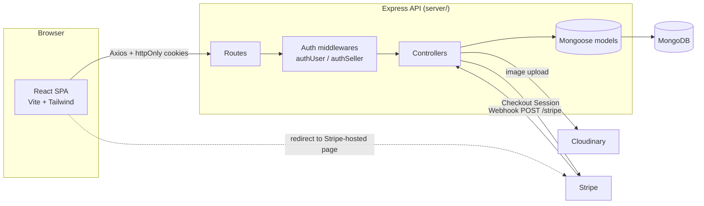
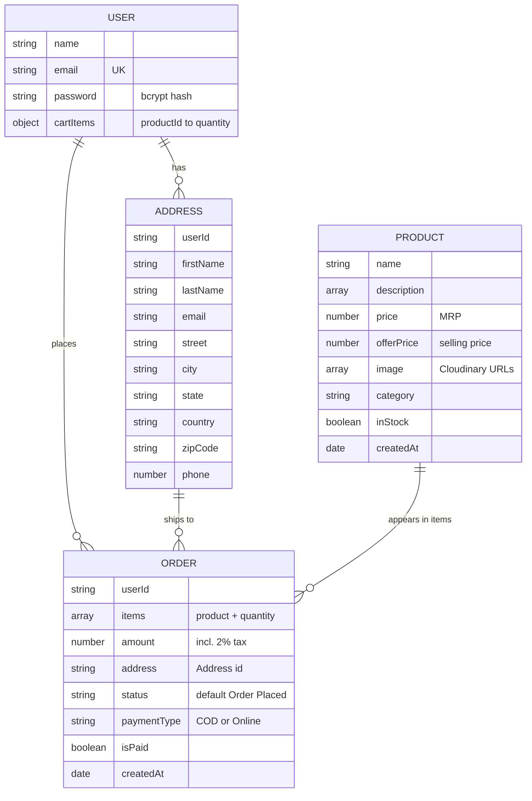
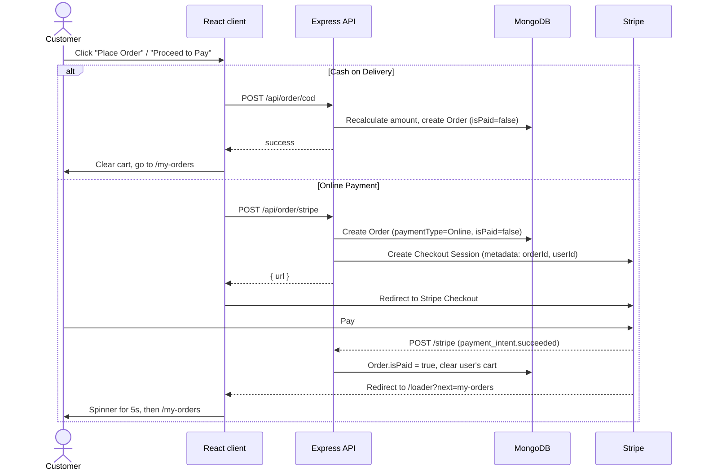

<div align="center">

# 🥬 GreenCart

### A full-stack grocery e-commerce platform built with the MERN stack

Browse fresh groceries, manage a cart, pay by **Cash on Delivery** or **Stripe**, and run the store from a dedicated **seller dashboard**.


</div>

---

## 📑 Table of Contents

1. [Overview](#-overview)
2. [Features](#-features)
3. [Tech Stack](#-tech-stack)
4. [Architecture](#-architecture)
5. [Project Structure](#-project-structure)
6. [Getting Started](#-getting-started)
7. [Environment Variables](#-environment-variables)
8. [API Reference](#-api-reference)
9. [Data Models](#-data-models)
10. [Key Flows](#-key-flows)
11. [Frontend Routes](#-frontend-routes)
12. [Deployment (Vercel)](#-deployment-vercel)
13. [Known Issues & Roadmap](#-known-issues--roadmap)
14. [Security Checklist](#-security-checklist-before-you-push)
15. [Contributing](#-contributing)
16. [License](#-license)

---

## 📖 Overview

**GreenCart** is an online grocery store with two sides:

- **Customer storefront**: browse products by category, search, view details, build a cart that syncs to the database, save delivery addresses, and place orders (COD or online payment through Stripe Checkout).
- **Seller dashboard**: a protected admin area where the store owner adds products (with multi-image upload to Cloudinary), toggles stock availability, and views all customer orders.

The repository is a monorepo with two independent apps:

| Folder    | Role                                   | Default port |
| --------- | -------------------------------------- | ------------ |
| `client/` | React single-page application (Vite)   | `5173`       |
| `server/` | REST API (Express + MongoDB)           | `4000`       |

---

## ✨ Features

### 🛍️ Customer

- **Authentication**: register / login / logout with JWT stored in an `httpOnly` cookie (7-day expiry); passwords hashed with `bcryptjs`.
- **Product catalogue**: home page with banners, 7 category tiles, a "Best Sellers" strip, an all-products page, per-category pages, and a product detail page with an image gallery and related products.
- **Live search**: the navbar search box filters products by name and jumps to the products page.
- **Persistent cart**: add / remove / change quantity; the cart is saved to the user's document in MongoDB on every change, so it follows the user across devices.
- **Address book**: add shipping addresses and choose one at checkout.
- **Checkout**: **Cash on Delivery** or **Online Payment (Stripe Checkout, INR)**, with a 2% tax line and free shipping.
- **Order history**: "My Orders" lists paid / COD orders with items, quantities, amount, status and date.
- **Responsive UI** with toast notifications (`react-hot-toast`) and a mobile menu.

### 🧑‍🌾 Seller (admin)

- **Separate login** at `/seller` (single seller account configured through environment variables).
- **Add Product**: name, description (one bullet per line), category, price, offer price, and up to **4 images** uploaded to Cloudinary.
- **Product List**: see every product and flip its **In Stock** toggle (out-of-stock products disappear from the storefront).
- **Orders**: view all COD and paid orders with customer name, delivery address, phone, amount, payment method and payment status.

---

## 🧰 Tech Stack

### Frontend (`client/`)

| Purpose          | Technology                                    |
| ---------------- | --------------------------------------------- |
| UI library       | React 19                                      |
| Build tool       | Vite 7                                        |
| Styling          | Tailwind CSS 4 (`@tailwindcss/vite`), Outfit font |
| Routing          | React Router DOM 7                            |
| HTTP client      | Axios (`withCredentials = true`)              |
| Notifications    | react-hot-toast                               |
| State management | React Context API (`AppContext`)              |
| Linting          | ESLint 9 (react-hooks, react-refresh)         |

### Backend (`server/`)

| Purpose            | Technology                              |
| ------------------ | --------------------------------------- |
| Runtime / framework| Node.js (ES Modules), Express 5         |
| Database / ODM     | MongoDB, Mongoose 8                     |
| Authentication     | JSON Web Tokens, bcryptjs, cookie-parser|
| File uploads       | Multer → Cloudinary                     |
| Payments           | Stripe (Checkout Sessions + Webhooks)   |
| Other              | cors, dotenv, nodemon (dev)             |

---

## 🏗️ Architecture



**How the pieces talk to each other**

- The client sets `axios.defaults.baseURL` from `VITE_BACKEND_URL` and always sends cookies, so the browser's `token` / `sellerToken` cookies authenticate each call.
- Every API response is JSON shaped like `{ success: boolean, message?: string, ...data }`. Errors are returned with HTTP 200 and `success: false` in most controllers.
- `authUser` verifies the user JWT and injects `userId` into `req.body`, so controllers never trust a user id sent by the client.
- `authSeller` verifies the seller JWT and checks that its email equals `SELLER_EMAIL`.
- The Stripe webhook route is registered **before** `express.json()` and uses `express.raw()`, which is required for signature verification.

---

## 📂 Project Structure

```
Green Cart MERN/
├── .gitignore
├── client/                          # React + Vite frontend
│   ├── index.html
│   ├── vite.config.js               # React + Tailwind plugins
│   ├── vercel.json                  # SPA rewrite for React Router
│   ├── eslint.config.js
│   ├── package.json
│   ├── public/                      # favicon
│   └── src/
│       ├── main.jsx                 # BrowserRouter + AppContextProvider
│       ├── App.jsx                  # route table, seller/user layout switch
│       ├── index.css                # Tailwind import, theme colors, font
│       ├── assets/                  # images, icons, assets.js (categories, dummy data)
│       ├── context/
│       │   └── AppContext.jsx       # global state: user, seller, products, cart, axios
│       ├── components/
│       │   ├── Navbar.jsx, Footer.jsx, Login.jsx, Loading.jsx
│       │   ├── MainBanner.jsx, Categories.jsx, BestSeller.jsx
│       │   ├── BottomBanner.jsx, NewsLetter.jsx, ProductCard.jsx
│       │   └── seller/SellerLogin.jsx
│       └── pages/
│           ├── Home.jsx, AllProducts.jsx, ProductCategory.jsx, ProductDetails.jsx
│           ├── Cart.jsx, AddAddress.jsx, MyOrders.jsx
│           └── seller/              # SellerLayout, AddProduct, ProductList, Orders
│
└── server/                          # Express + MongoDB backend
    ├── server.js                    # app bootstrap, CORS, route mounting, Stripe webhook
    ├── vercel.json                  # Vercel serverless config
    ├── package.json
    ├── configs/
    │   ├── db.js                    # Mongoose connection (database: "greencart")
    │   ├── cloudinary.js            # Cloudinary SDK config
    │   └── multer.js                # multer disk storage
    ├── middlewares/
    │   ├── authUser.js              # verifies "token" cookie
    │   └── authSeller.js            # verifies "sellerToken" cookie
    ├── models/                      # User, Product, Address, Order
    ├── controllers/                 # user, seller, product, cart, address, order
    └── routes/                      # one router per resource
```

---

## 🚀 Getting Started

### Prerequisites

- **Node.js** 20.19+ or 22.12+ (required by Vite 7; Express 5 needs 18+)
- **npm** or **yarn** (the client ships a `yarn.lock`, the server a `package-lock.json`)
- A **MongoDB** database (local or [MongoDB Atlas](https://www.mongodb.com/atlas))
- A free **[Cloudinary](https://cloudinary.com/)** account (product images)
- A **[Stripe](https://stripe.com/)** account in test mode (online payments) and the [Stripe CLI](https://docs.stripe.com/stripe-cli) (local webhooks)

### 1. Clone the repository

```bash
git clone https://github.com/<your-username>/<your-repo-name>.git
cd "<your-repo-name>"
```

### 2. Set up the backend

```bash
cd server
npm install
# create server/.env and fill in the values (see "Environment Variables" below)
npm run server           # starts with nodemon on http://localhost:4000
# or: npm start          # plain node, no auto-reload
```

You should see `Connected to MongoDB` and `Server is running on http://localhost:4000`. Opening `http://localhost:4000/` returns `API is Working...!`.

### 3. Set up the frontend

Open a second terminal:

```bash
cd client
yarn install             # or: npm install
# create client/.env (see "Environment Variables" below)
yarn dev                 # or: npm run dev  → http://localhost:5173
```

### 4. Add your first products

There is **no seed script**: a fresh database has no products.

1. Go to `http://localhost:5173/seller` (there is no link to it in the UI, so type the URL).
2. Log in with the `SELLER_EMAIL` / `SELLER_PASSWORD` you set in `server/.env`.
3. Use **Add Product** to create items. The **Category** must be one of the seven values the storefront understands:
   `Vegetables`, `Fruits`, `Drinks`, `Instant`, `Dairy`, `Bakery`, `Grains`.

> `client/src/assets/assets.js` contains ~40 `dummyProducts` (with local images). They are sample data from the UI template, not wired to the database, but they are a handy reference for realistic names, prices and descriptions.

### 5. Test Stripe payments locally

Stripe needs to call your server when a payment succeeds, so forward webhooks with the Stripe CLI:

```bash
stripe login
stripe listen --forward-to localhost:4000/stripe
```

The CLI prints a signing secret starting with `whsec_`. Put it in `server/.env` as `STRIPE_WEBHOOK_SECRET` and restart the server. Pay with Stripe's test card `4242 4242 4242 4242` (any future expiry, any CVC).

### Available scripts

| Location  | Command           | Description                          |
| --------- | ----------------- | ------------------------------------ |
| `client/` | `yarn dev`        | Start Vite dev server with HMR       |
| `client/` | `yarn build`      | Production build into `dist/`        |
| `client/` | `yarn preview`    | Preview the production build         |
| `client/` | `yarn lint`       | Run ESLint                           |
| `server/` | `npm run server`  | Start API with nodemon (development) |
| `server/` | `npm start`       | Start API with node (production)     |

---

## 🔐 Environment Variables

Create the two files below. **Never commit real values.** It's a good idea to also commit copies of these templates, with placeholder values only, as `server/.env.example` and `client/.env.example`.

### `server/.env`

```env
# --- Server ---
PORT=4000
NODE_ENV=development            # must be "production" when deployed (controls cookie flags)
JWT_SECRET=replace_with_a_long_random_string

# --- Seller (admin) login ---
SELLER_EMAIL=seller@example.com
SELLER_PASSWORD=choose_a_strong_password

# --- MongoDB ---
# Do NOT include a database name or query string; the app appends "/greencart".
MONGODB_URL=mongodb+srv://<user>:<password>@<cluster>.mongodb.net

# --- Cloudinary ---
CLOUDINARY_CLOUD_NAME=your_cloud_name
CLOUDINARY_API_KEY=your_api_key
CLOUDINARY_API_SECRET=your_api_secret

# --- Stripe ---
STRIPE_SECRET_KEY=sk_test_xxx
STRIPE_WEBHOOK_SECRET=whsec_xxx
STRIPE_PUBLISHABLE_KEY=pk_test_xxx   # present in the project but not used by the code today
```

| Variable | Required | Used for |
| --- | :---: | --- |
| `PORT` | no | API port (defaults to `4000`) |
| `NODE_ENV` | yes | `production` enables `secure` + `sameSite=none` cookies (needed for cross-site deployments) |
| `JWT_SECRET` | yes | Signs and verifies user and seller JWTs |
| `SELLER_EMAIL`, `SELLER_PASSWORD` | yes | The single seller/admin credential pair |
| `MONGODB_URL` | yes | MongoDB connection string **without** database name; `/greencart` is appended in `configs/db.js` |
| `CLOUDINARY_*` | yes | Product image uploads |
| `STRIPE_SECRET_KEY` | for online payments | Creating Checkout Sessions |
| `STRIPE_WEBHOOK_SECRET` | for online payments | Verifying webhook signatures |
| `STRIPE_PUBLISHABLE_KEY` | no | Not referenced by the current code |

### `client/.env`

```env
VITE_BACKEND_URL=http://localhost:4000
VITE_CURRENCY=₹
```

| Variable | Description |
| --- | --- |
| `VITE_BACKEND_URL` | Base URL of the API (no trailing slash) |
| `VITE_CURRENCY` | Currency symbol displayed in the UI |

> Vite only exposes variables prefixed with `VITE_`, and restarting the dev server is required after changing `.env`.

---

## 📡 API Reference

Base URL: `http://localhost:4000`. All endpoints return JSON. **Auth** column: 🌐 public · 👤 requires user cookie (`token`) · 🧑‍🌾 requires seller cookie (`sellerToken`).

### Users: `/api/user`

| Method | Endpoint     | Auth | Body | Description |
| ------ | ------------ | :--: | ---- | ----------- |
| POST   | `/register`  | 🌐 | `{ name, email, password }` | Create account, hash password, set `token` cookie |
| POST   | `/login`     | 🌐 | `{ email, password }` | Verify credentials, set `token` cookie |
| GET    | `/is-auth`   | 👤 | – | Return the logged-in user (without password) and their `cartItems` |
| GET    | `/logout`    | 👤 | – | Clear the `token` cookie |

### Seller: `/api/seller`

| Method | Endpoint     | Auth | Body | Description |
| ------ | ------------ | :--: | ---- | ----------- |
| POST   | `/login`     | 🌐 | `{ email, password }` | Compare with `SELLER_EMAIL` / `SELLER_PASSWORD`, set `sellerToken` cookie |
| GET    | `/is-auth`   | 🧑‍🌾 | – | Confirms the seller session is valid |
| POST   | `/logout`    | 🌐 | – | Clear the `sellerToken` cookie |

### Products: `/api/product`

| Method | Endpoint  | Auth | Body | Description |
| ------ | --------- | :--: | ---- | ----------- |
| POST   | `/add`    | 🧑‍🌾 | `multipart/form-data`: `productData` (JSON string with `name, description[], category, price, offerPrice`) + `images` files | Upload images to Cloudinary and create the product |
| GET    | `/list`   | 🌐 | – | List all products |
| GET    | `/id`     | 🌐 | `{ id }` (read from `req.body`) | Get one product (see [Known Issues](#-known-issues--roadmap)) |
| POST   | `/stock`  | 🧑‍🌾 | `{ id, inStock }` | Toggle product availability |

### Cart: `/api/cart`

| Method | Endpoint   | Auth | Body | Description |
| ------ | ---------- | :--: | ---- | ----------- |
| POST   | `/update`  | 👤 | `{ cartItems }` (`{ [productId]: quantity }`) | Overwrite the user's saved cart |

### Addresses: `/api/address`

| Method | Endpoint | Auth | Body | Description |
| ------ | -------- | :--: | ---- | ----------- |
| POST   | `/add`   | 👤 | `{ address: { firstName, lastName, email, street, city, state, country, zipCode?, phone } }` | Save an address for the current user |
| GET    | `/get`   | 👤 | – | List the current user's addresses |

### Orders: `/api/order`

| Method | Endpoint  | Auth | Body | Description |
| ------ | --------- | :--: | ---- | ----------- |
| POST   | `/cod`    | 👤 | `{ items: [{ product, quantity }], address }` | Place a Cash-on-Delivery order |
| POST   | `/stripe` | 👤 | `{ items, address }` | Create a pending order + Stripe Checkout Session, returns `{ url }` |
| GET    | `/user`   | 👤 | – | Orders of the current user (COD or paid), newest first |
| GET    | `/seller` | 🧑‍🌾 | – | All orders (COD or paid), newest first |

### Webhook

| Method | Endpoint  | Auth | Description |
| ------ | --------- | :--: | ----------- |
| POST   | `/stripe` | Stripe signature | Handles `payment_intent.succeeded` (marks order paid, empties cart) and `payment_intent.payment_failed` (deletes the pending order) |

> **Pricing is calculated on the server** from the database's `offerPrice`, not from the client, with a 2% tax added (`Math.floor(subtotal * 0.02)`).

---

## 🗄️ Data Models



Mongoose collection names are `users`, `products`, `addresses`, `orders` inside the `greencart` database. Relations are stored as string ids and resolved with `.populate()` (`items.product`, `address`).

---

## 🔄 Key Flows

### Authentication

1. `POST /api/user/login` verifies the password with bcrypt and signs a JWT `{ id }` valid for 7 days.
2. The JWT is sent back as an `httpOnly` cookie named `token`. In production the cookie is `secure` with `sameSite=none` (client and API live on different domains); in development it is `sameSite=strict`.
3. On app start, `AppContext` calls `/api/user/is-auth` and `/api/seller/is-auth` to restore both sessions, then loads the product list.

The seller flow is identical but uses the `sellerToken` cookie and a JWT payload of `{ email }`.

### Cart synchronisation

The cart lives in React state as `{ [productId]: quantity }`. Whenever it changes **and a user is logged in**, `AppContext` posts it to `/api/cart/update`, which stores it on the user document. On the next visit, `/api/user/is-auth` returns it and the state is restored.

### Order and payment



Unpaid online orders are hidden from both "My Orders" and the seller's order list, because the queries only return `paymentType === "COD"` **or** `isPaid === true`.

### Product creation (seller)

`AddProduct` sends `multipart/form-data` → `multer` saves files to a temporary location → each file is uploaded to Cloudinary → the returned `secure_url`s are stored in `Product.image`.

---

## 🧭 Frontend Routes

| Path | Component | Access | Notes |
| ---- | --------- | ------ | ----- |
| `/` | `Home` | Public | Banner, categories, best sellers, newsletter |
| `/products` | `AllProducts` | Public | Only in-stock items; honours navbar search |
| `/products/:category` | `ProductCategory` | Public | e.g. `/products/vegetables` |
| `/products/:category/:id` | `ProductDetails` | Public | Gallery, add to cart, "Buy now", related products |
| `/cart` | `Cart` | Public* | Address picker, payment method, order summary |
| `/add-address` | `AddAddress` | User | Redirects to `/cart` if not logged in |
| `/my-orders` | `MyOrders` | User | Order history |
| `/loader?next=<path>` | `Loading` | Public | Spinner shown after Stripe, redirects after 5 s |
| `/seller` | `SellerLogin` → `SellerLayout` | Seller | Index route is **Add Product** |
| `/seller/product-list` | `ProductList` | Seller | Stock toggles |
| `/seller/orders` | `Orders` | Seller | All customer orders |

\* Browsing the cart works for guests; the user login modal is opened from the navbar, and the checkout calls require a logged-in user.

Any path containing `seller` hides the customer navbar and footer.

---

## ☁️ Deployment (Vercel)

Both apps include a `vercel.json` and are designed to be deployed as **two separate Vercel projects**.

**Backend (`server/`)**

1. Import the repo in Vercel and set the **Root Directory** to `server`.
2. Add **all** variables from `server/.env` in *Project Settings → Environment Variables*, with `NODE_ENV=production`.
3. `server/vercel.json` builds `server.js` with `@vercel/node` and routes every request to it.
4. In the Stripe Dashboard → *Developers → Webhooks*, add an endpoint `https://<your-api-domain>/stripe` listening to `payment_intent.succeeded` and `payment_intent.payment_failed`, then copy its signing secret into `STRIPE_WEBHOOK_SECRET`.
5. **Update the CORS allow-list** in `server/server.js` (`allowedOrigins`) with your real frontend URL.

**Frontend (`client/`)**

1. Create a second Vercel project with **Root Directory** `client` (Vite preset).
2. Set `VITE_BACKEND_URL` to your deployed API URL and `VITE_CURRENCY` to `₹` (or your currency symbol).
3. `client/vercel.json` rewrites every path to `/` so React Router deep links (e.g. `/products/fruits`) work on refresh.

> ⚠️ Because the API and the client are on different domains, auth cookies only work when `NODE_ENV=production` (`secure` + `sameSite=none`) **and** the API is served over HTTPS **and** the client origin is in `allowedOrigins`.

---

## 🐞 Known Issues & Roadmap

An honest review of the current code. These are good first issues for contributors.

### Should fix soon

| # | Where | Issue | Suggested fix |
| - | ----- | ----- | ------------- |
| 1 | `controllers/SellerController.js` | Wrong seller credentials return `success: true` ("Invalid Cridentails"), so the client believes the login worked and shows the dashboard. | Return `success: false` (ideally with HTTP 401). |
| 2 | `routes/productRoute.js` | `upload.array(...)` runs **before** `authSeller`, so unauthenticated requests can write files to the server's temp directory. | Put `authSeller` first: `post("/add", authSeller, upload.array("images"), addProduct)`. |
| 3 | `controllers/orderController.js` (`stripeWebhooks`) | After a failed signature check the handler responds with 400 but doesn't `return`, so execution continues with an undefined `event`. | Add `return` after sending the 400. |
| 4 | `pages/AddAddress.jsx` vs `models/Address.js` | The form sends `zipcode`, the schema field is `zipCode`, so the ZIP is silently dropped (the seller orders view reads `zipcode` too). | Use one spelling everywhere. |
| 5 | `pages/AddAddress.jsx` | Toasts read `data.messsage` (three s's), so success/error messages show `undefined`. | Use `data.message` / `error.message`. |
| 6 | `controllers/orderController.js` | Stripe line items use `Math.floor(price + price * 0.02) * 100` per unit while the stored order amount uses `Math.floor(subtotal * 0.02)` on the total, so the amount charged can differ slightly from the recorded amount. | Compute totals in one place and reuse them. |
| 7 | `.env` setup | `NODE_ENV` in the sample env is misspelled `developement`; the deployed value must be exactly `production` for cookies to work cross-site. | Document and validate at startup. |

### Nice to have

- `models/User.js`: `password` is marked `unique: true`, which is unnecessary (and odd) for a hash; remove it.
- Webhook clears the cart with `[]`, but the schema default is `{}`; use `{}`.
- `GET /api/product/id` reads `id` from `req.body`; GET requests normally have no body. Switch to `/api/product/:id`. (The client does not currently call this endpoint.)
- `Navbar` links to `/contact`, which has no route; the mobile "My Orders" item points to `/products`; the newsletter form does nothing.
- Register error message typo: `"Mission Details"` → `"Missing details"`.
- Order `status` is always "Order Placed"; add seller controls to update it (Processing, Shipped, Delivered…).
- Missing features: edit / delete product, pagination, password rules and rate-limiting on login, forgot-password, reviews (the star rating is currently hard-coded to 4), input validation (e.g. `zod` / `express-validator`), automated tests.
- Move `allowedOrigins` in `server.js` to an environment variable.
- Return proper HTTP status codes (401 / 403 / 404 / 500) instead of always `200`.
- Convert to TypeScript, and add a seed script for demo products.

---

## 🛡️ Security Checklist (before you push)

- [ ] **Add `.env` to `.gitignore`.** The root `.gitignore` currently ignores only `node_modules`, and the client one doesn't cover `.env`, so both `.env` files would be committed.
  ```gitignore
  node_modules
  .env
  .env.*
  !.env.example
  ```
- [ ] **Rotate every secret that has ever been in a committed or shared `.env`**: MongoDB user password, Cloudinary API secret, Stripe keys / webhook secret, `JWT_SECRET`, and the seller password. Deleting the file later does not remove it from Git history.
- [ ] Use a long random `JWT_SECRET` (e.g. `node -e "console.log(require('crypto').randomBytes(48).toString('hex'))"`).
- [ ] Commit `server/.env.example` and `client/.env.example` with placeholder values only.
- [ ] Use Stripe **test** keys until you are fully ready to go live.
- [ ] Restrict MongoDB Atlas network access to the IPs you need.

---

## 🤝 Contributing

1. Fork the repository
2. Create a feature branch: `git checkout -b feature/amazing-feature`
3. Commit your changes: `git commit -m "Add amazing feature"`
4. Push the branch: `git push origin feature/amazing-feature`
5. Open a Pull Request

---

## 📄 License

The server `package.json` declares the **ISC** license. Add a `LICENSE` file to the repository root to make this official, or replace it with the license of your choice.

---

<div align="center">

Built with 💚 using the MERN stack · Feel free to ⭐ the repo if it helped you!

</div>
